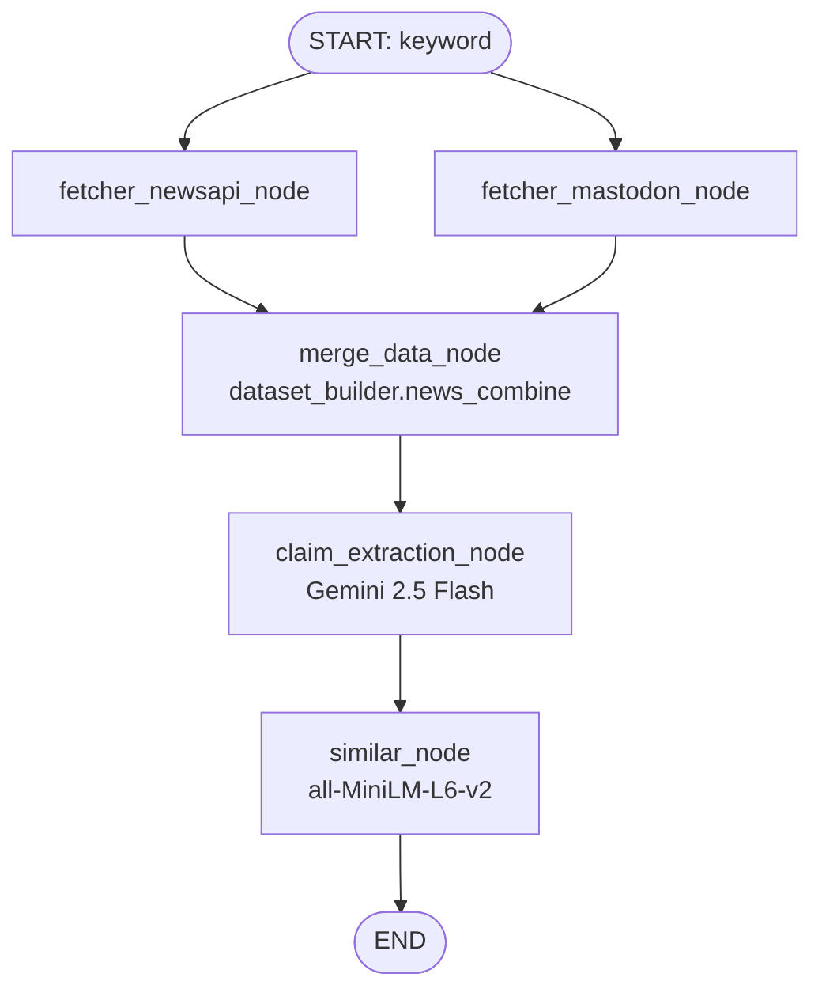

# MisTrack AI — Misinformation Propagation Tracker & Killchain Analyzer

> An Agentic AI and Machine Learning system designed to collect news and social data, extract factual claims, measure semantic similarity across sources, and analyze misinformation spread.

[](LICENSE)
-orange)

---

## 1. Introduction

**MisTrack AI** is an AI/ML engineering project that combines **LangGraph** multi-agent orchestration, **Google Gemini** claim extraction, **SentenceTransformers** semantic similarity, and classical **Machine Learning** models (`scikit-learn` and `XGBoost`) to track how claims appear and relate across news and social platforms.

The long-term architecture pairs this intelligence layer with a NetworkX propagation graph, a FastAPI REST backend, and a Streamlit visualization dashboard. Currently, development has focused on the **data ingestion pipeline, LangGraph agent orchestration, and ML training/prediction scripts**.

---

## 2. Problem Statement

Misinformation spreads rapidly across news outlets and social media platforms, often mutating as it is shared. Manual fact-checking struggles to keep pace with how claims are rephrased, amplified, or pushed by automated accounts. MisTrack AI aims to automate the collection, claim extraction, similarity matching, and risk signal modeling needed to trace how a story propagates.

---

## 3. Project Objectives

- Collect related articles and account/post records from external APIs for a given keyword.
- Unify multi-source data into a structured dataset for downstream NLP and ML processing.
- Extract concise, single-sentence factual claims from raw text using an LLM.
- Compute semantic similarity between extracted claims to identify related or repeated narratives.
- Train classical ML models for virality prediction, bot account detection, and danger score estimation.
- *(Planned)* Build a NetworkX propagation graph, expose REST endpoints via FastAPI, and visualize results in Streamlit.

---

## 4. Key Features (Implemented)

- **Multi-Source Data Ingestion:**
  - `newsapi_fetcher.py`: Fetches articles from NewsAPI (`/v2/everything`) with rate limiting (`@limits`) and exports raw CSVs.
  - `mastodon_fetcher.py`: Queries Mastodon (`/api/v2/search`) with rate limiting and exports account metadata to CSV.
  - `dataset_builder.py`: Aligns and combines NewsAPI and Mastodon DataFrames into `unified_dataset.csv`.
- **LLM Claim Extraction:**
  - `claim_extractor.py`: Uses LangChain (`PromptTemplate` + `ChatGoogleGenerativeAI` with `gemini-2.5-flash`) to extract a one-sentence factual claim from each record's `title` and `description` (with fallback to `title` on errors).
- **Semantic Similarity Engine:**
  - `similarity_engine.py`: Encodes `extracted_claim` values using `sentence-transformers` (`all-MiniLM-L6-v2`, normalized embeddings) and computes pairwise cosine similarity via dot product, saving pairs above a threshold to `similarity_dataset.csv`.
- **LangGraph Multi-Agent Orchestration:**
  - `pipeline.py`: Defines a `StateGraph` (`TypedDict` state) running `fetcher_newsapi_node` and `fetcher_mastodon_node` in parallel, followed by `merge_data_node`, `claim_extraction_node`, and `similar_node`.
- **Machine Learning Scripts:**
  - `virality_model.py` & `predict_virality.py`: Trains a `RandomForestClassifier` (`class_weight="balanced"`, `n_estimators=100`) combined with `TfidfVectorizer(max_features=1000)` on `virality_dataset.csv` and saves `.joblib` artifacts.
  - `bot_model.py` & `predict_bot.py`: Trains an `XGBClassifier` (`n_estimators=100`, `max_depth=5`, `learning_rate=0.3`) on `bot_dataset_enriched.csv` using `followers_to_friends_ratio` and `avg_daily_posts`.
  - `danger_score.py`: Scales `danger_score` values in `danger_score.csv` to a `0–100` range.

---

## 5. System Architecture

### Currently Implemented Pipeline (`backend/agents/pipeline.py`)



### Target End-to-End Architecture

- **Data & Agent Layer (`backend/agents/`):** Multi-source ingestion, LangGraph orchestration, claim extraction, and embedding similarity.
- **ML Layer (`backend/ml/models/`):** Virality Random Forest, Bot XGBoost classifier, and Danger Score modeling.
- **Graph Layer (`backend/graph/`):** *(Planned)* NetworkX directed propagation graph, centrality metrics, and community detection.
- **API Layer (`backend/api/`, `backend/main.py`):** *(Planned)* FastAPI server exposing analysis, graph, and PDF report endpoints.
- **Frontend Layer (`frontend/`):** *(Planned)* Streamlit multi-page UI with PyVis network graphs and Plotly dashboards.

---

## 6. Technology Stack

| Category | Technologies (from `requirements.txt` & Source) |
|---|---|
| **Language** | Python 3 |
| **Agentic AI & LLM** | `langchain`, `langchain-core`, `langchain-google-genai`, `langgraph`, `google-genai` |
| **Embeddings & NLP** | `sentence-transformers` (`all-MiniLM-L6-v2`), `transformers`, `nltk`, `textblob` |
| **Machine Learning** | `scikit-learn`, `xgboost`, `scipy`, `numpy`, `pandas`, `joblib` |
| **Data Collection** | `requests`, `praw` *(installed)*, `ratelimit` *(imported by fetchers)*, `python-dotenv` |
| **Graph & Visualization** *(installed for planned phases)* | `networkx`, `pyvis`, `plotly`, `reportlab` |
| **Backend & Frontend** *(installed for planned phases)* | `fastapi`, `uvicorn`, `pydantic`, `streamlit` |

---

## 7. Project Folder Structure

```text
MisTrack-AI/
├── backend/
│   ├── agents/
│   │   ├── claim_extractor.py      # LangChain + Gemini claim extraction
│   │   ├── dataset_builder.py      # Combines NewsAPI & Mastodon DataFrames
│   │   ├── mastodon_fetcher.py     # Mastodon search API fetcher
│   │   ├── newsapi_fetcher.py      # NewsAPI everything endpoint fetcher
│   │   ├── pipeline.py             # LangGraph StateGraph orchestration
│   │   └── similarity_engine.py    # MiniLM embeddings & pairwise similarity
│   ├── api/                        # Planned FastAPI routes & schemas (.gitkeep)
│   ├── graph/                      # Planned NetworkX propagation module (.gitkeep)
│   ├── ml/
│   │   └── models/
│   │       ├── bot_model.py        # XGBoost bot classifier training script
│   │       ├── danger_score.py     # Danger score scaling script
│   │       ├── predict_bot.py      # Bot model inference test script
│   │       ├── predict_virality.py # Virality model loader script
│   │       └── virality_model.py   # Random Forest + TF-IDF training script
│   └── main.py                     # Placeholder backend entry point
├── data/
│   ├── processed/                  # Generated processed CSVs (gitignored)
│   └── raw/                        # Generated raw API CSVs (gitignored)
├── frontend/
│   ├── pages/                      # Planned Streamlit pages (.gitkeep)
│   └── app.py                      # Placeholder (currently empty)
├── notebooks/                      # (.gitkeep)
├── tests/                          # (.gitkeep)
├── .env.example                    # Template for API keys and base URLs
├── .gitignore
├── LICENSE                         # MIT License
├── MisTrack-AI Project Blueprint.md
├── MisTrack_AI_Implementation_Phases.md
├── README.md
└── requirements.txt
```

---

## 8. Installation & Setup

### Prerequisites
- Python 3.10+
- `pip`

### Steps

1. **Clone the repository:**
   ```bash
   git clone https://github.com/vamsikrishna51829/MisTrack-AI.git
   cd MisTrack-AI
   ```

2. **Create and activate a virtual environment:**
   ```bash
   python3 -m venv .venv
   source .venv/bin/activate
   ```

3. **Install dependencies:**
   ```bash
   pip install -r requirements.txt
   pip install ratelimit
   ```
   > **Note:** `ratelimit` is imported by `newsapi_fetcher.py` and `mastodon_fetcher.py`, so install it alongside `requirements.txt`.

---

## 9. Environment Variables & API Configuration

Copy `.env.example` to `.env` and populate your credentials:

```bash
cp .env.example .env
```

Variables defined in `.env.example`:

| Variable | Purpose | Required For |
|---|---|---|
| `GEMINI_API_KEY` | Google Gemini API key | `claim_extractor.py` |
| `NEWS_API_KEY` | NewsAPI key | `newsapi_fetcher.py` |
| `MASTODON_BASE_URL` | Mastodon instance URL (default: `https://mastodon.social`) | `mastodon_fetcher.py` |
| `MASTODON_ACCESS_TOKEN` | Mastodon API token | `mastodon_fetcher.py` |
| `REDDIT_CLIENT_ID` | Reddit API client ID *(planned)* | Future Reddit fetcher |
| `REDDIT_SECRET` | Reddit API secret *(planned)* | Future Reddit fetcher |
| `REDDIT_USER_AGENT` | Reddit user agent (`MisTrackAI/1.0`) *(planned)* | Future Reddit fetcher |
| `GDELT_BASE_URL` | GDELT v2 base URL (`https://api.gdeltproject.org/api/v2`) *(planned)* | Future GDELT fetcher |

---

## 10. Running the Project Locally

> **Important:** Current agent and ML scripts use relative paths (e.g., `../../data/...`, `../trained_models/...`) and bare module imports, so they should be executed from their respective directories. Also note that `.csv` datasets and `.joblib` model artifacts are gitignored and not included in the repository.

### Run the LangGraph Agent Pipeline
```bash
cd backend/agents
python3 pipeline.py
```
*(Currently invokes the graph with the hardcoded keyword `"Dengue"`.)*

### Run ML Training Scripts *(requires prepared CSVs in `data/processed/` and `backend/ml/trained_models/` directory)*
```bash
mkdir -p backend/ml/trained_models
cd backend/ml/models
python3 virality_model.py
python3 bot_model.py
```

### Run Backend Placeholder
```bash
python3 backend/main.py
```

---

## 11. Data Pipeline & AI/ML Workflow

1. **Ingestion (`newsapi_fetcher.py`, `mastodon_fetcher.py`):** Queries NewsAPI and Mastodon for a keyword and writes raw CSVs (`newsapi_KEYWORD_TIMESTAMP.csv`, `Mastodonapi_KEYWORD_TIMESTAMP.csv`) into `data/raw/`.
2. **Dataset Unification (`dataset_builder.py`):** Renames Mastodon fields (`username` → `author`, `created_at` → `publishedAt`, `display_name` → `title`, `note` → `description`), tags `platform`, concatenates both DataFrames, and writes `data/processed/unified_dataset.csv`.
3. **Claim Extraction (`claim_extractor.py`):** Sends each row's `title` and `description` to `gemini-2.5-flash` via LangChain and appends an `extracted_claim` column to `unified_dataset.csv`.
4. **Similarity Scoring (`similarity_engine.py`):** Encodes `extracted_claim` with `all-MiniLM-L6-v2` and saves sentence pairs with cosine similarity `>= threshold` (`0.6` in `pipeline.py`, `0.8` when run standalone) to `data/processed/similarity_dataset.csv`.
5. **ML Modeling (`backend/ml/models/`):**
   - **Virality Predictor:** `TfidfVectorizer` on `title` + tabular features → `RandomForestClassifier`.
   - **Bot Detector:** `followers_to_friends_ratio` + `avg_daily_posts` → `XGBClassifier`.
   - **Danger Score:** `danger_score.py` currently scales `danger_score.csv` values by `100`.

---

## 12. API Documentation

A FastAPI REST API is planned for Phase 3, but **no API endpoints are implemented yet**. `backend/main.py` currently serves as a placeholder script, and `backend/api/` contains only `.gitkeep`.

---

## 13. Current Implementation Status

| Phase | Component | Status | Notes |
|---|---|---|---|
| **Phase 1** | Project Setup & Environment | Partially Completed | Folder layout, `requirements.txt`, and `.env.example` exist (`ratelimit` missing from `requirements.txt`). |
| **Phase 1** | Data Fetchers & Merger | Partially Completed | Implemented with NewsAPI + Mastodon instead of Reddit + GDELT; lacks URL-hash deduplication, text normalization, and sentiment columns. |
| **Phase 2** | Claim Extractor | Partially Completed | LangChain + Gemini extraction implemented; executes at import time. |
| **Phase 2** | Similarity Engine | Partially Completed | `all-MiniLM-L6-v2` pairwise similarity implemented; mutation classification (`mutation_type`) not implemented yet. |
| **Phase 2** | LangGraph Pipeline | Partially Completed | `StateGraph` implemented in `pipeline.py` with parallel fetchers; uses hardcoded keyword and relative paths. |
| **Phase 2** | ML Models (Virality, Bot, Danger) | Partially Completed | Training scripts exist for Virality (RF) and Bot (XGBoost); `danger_score.py` is a scaling script; `.joblib` artifacts are not tracked in Git. |
| **Phase 2** | Propagation Graph (`backend/graph/`) | Not Implemented | Directory contains `.gitkeep` only. |
| **Phase 3** | FastAPI Backend (`backend/api/`) | Not Implemented | `backend/main.py` is a stub; no endpoints or schemas exist yet. |
| **Phase 4** | Streamlit Frontend & Deployment | Not Implemented | `frontend/app.py` is empty; no pages or Hugging Face Space config exist yet. |

---

## 14. Future Improvements

- Add `if __name__ == "__main__":` guards, package-relative imports, and `pathlib` root-relative paths across `backend/agents/` and `backend/ml/models/`.
- Add `ratelimit` to `requirements.txt`, fix Mastodon Bearer token authentication, and use dynamic keyword/timestamp filenames.
- Implement URL-hash deduplication, text normalization, TextBlob sentiment scoring, and `mutation_type` classification.
- Complete the Ridge Regression danger score model, `predict_virality()` / `predict_bot()` inference functions, and `backend/graph/propagation.py`.
- Build the FastAPI backend (`backend/main.py`, `backend/api/schemas.py`, `backend/api/routes.py`) and Streamlit multi-page UI (`frontend/`).
- Add automated unit tests in `tests/`.

---

## 15. Contributors & License

- **Author:** Vamsi Krishna Dasari (`@vamsikrishna51829`)
- **License:** Licensed under the [MIT License](LICENSE).
